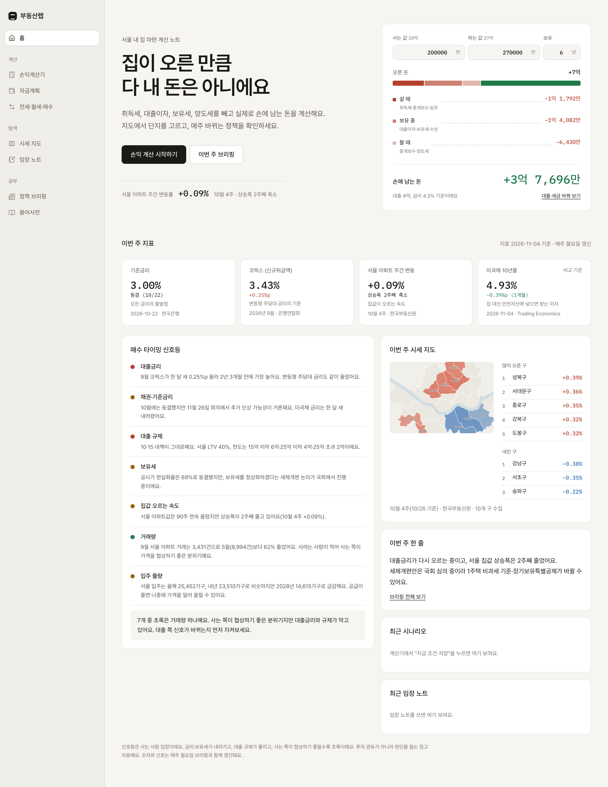
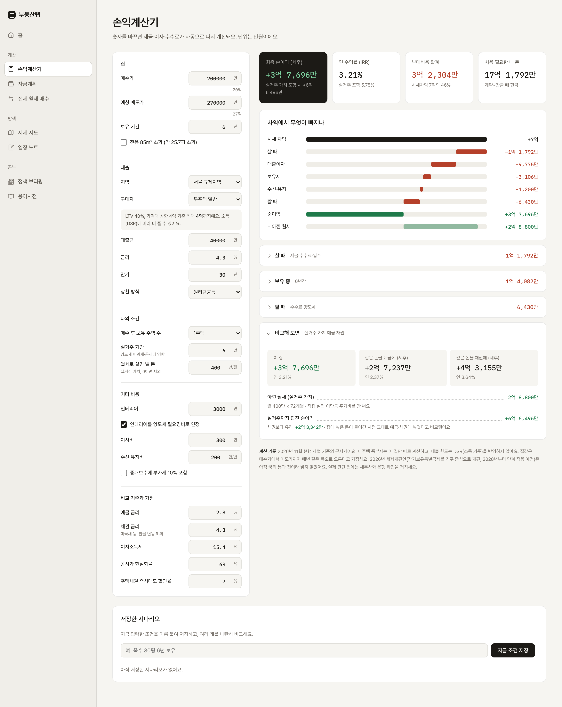
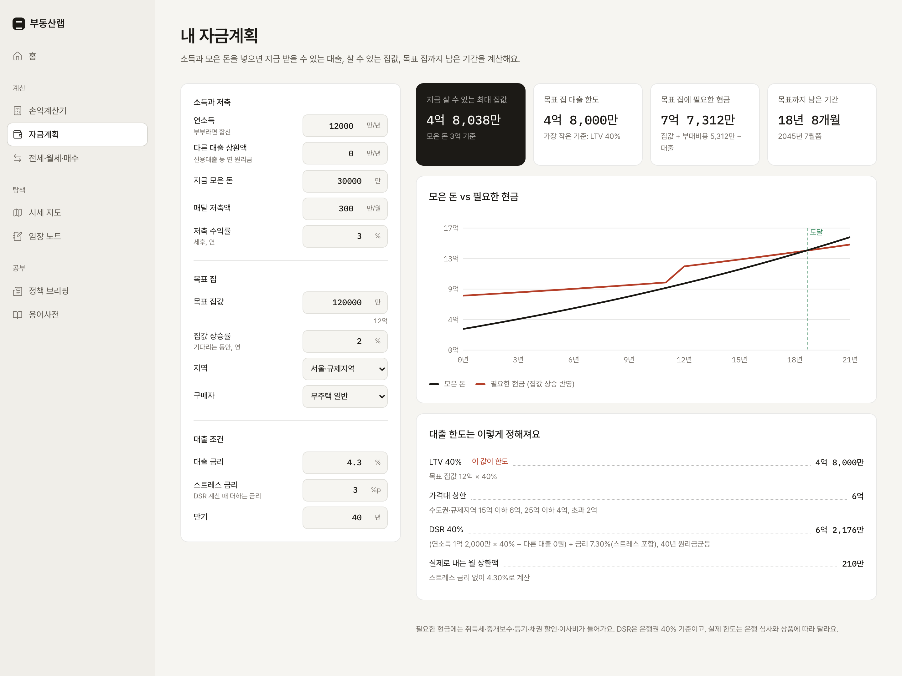
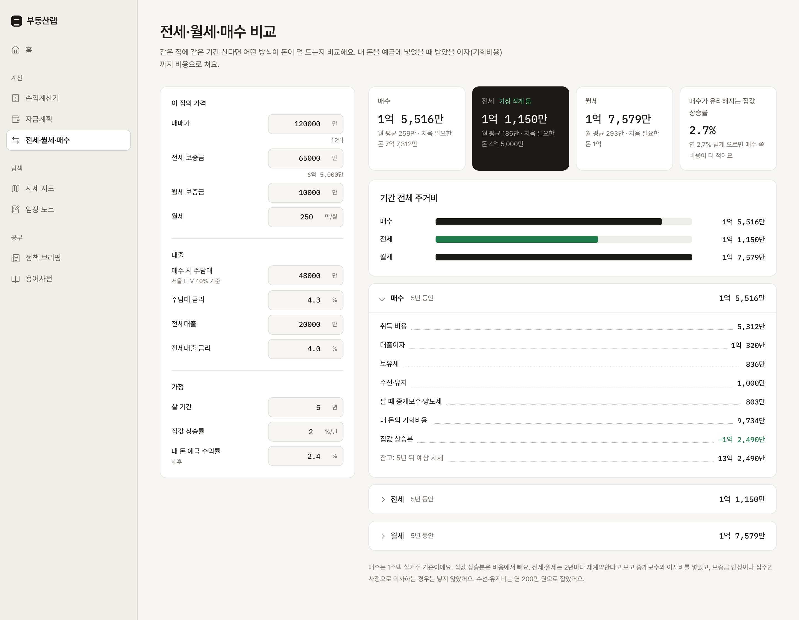
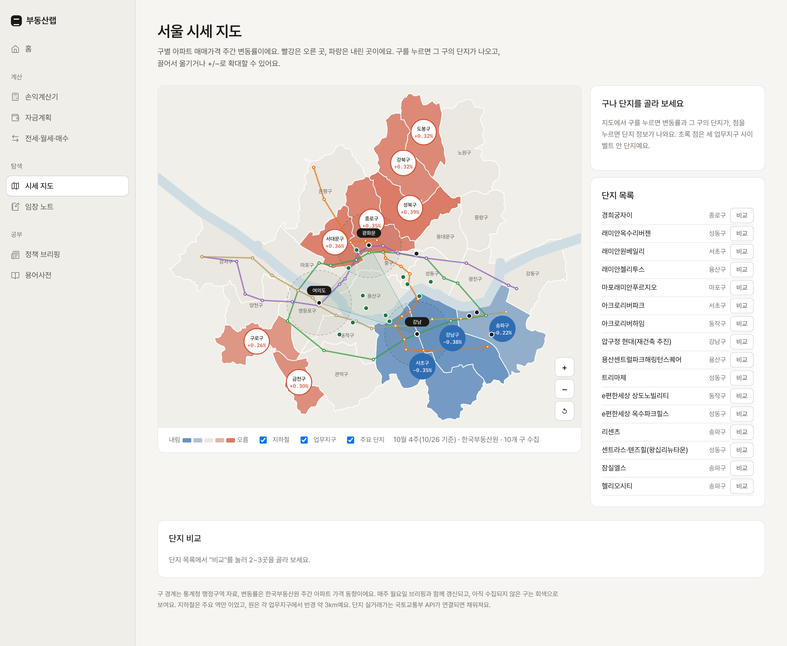
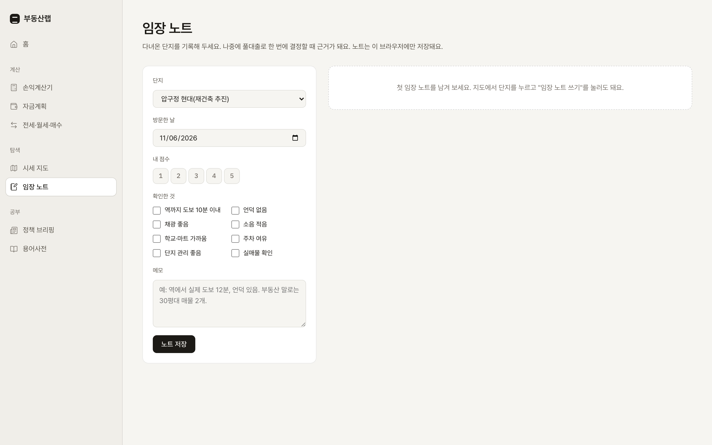
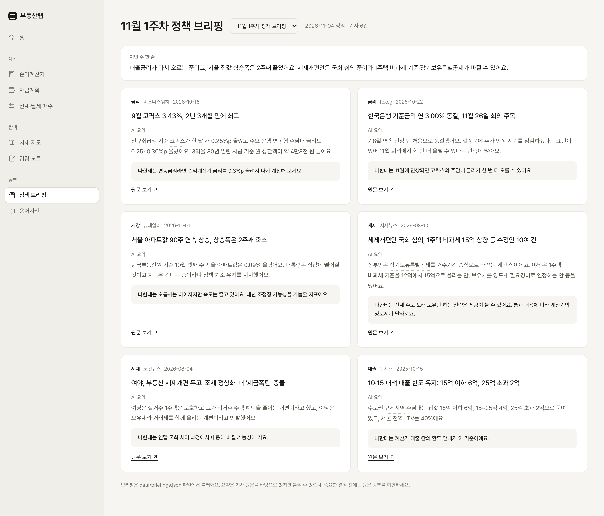
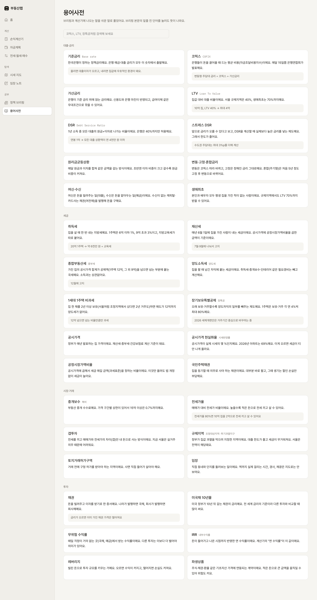

# 부동산랩

서울 내 집 마련 계산 노트

- 집이 오른 만큼 다 내 돈은 아니다. 고로 취득세, 대출이자, 보유세, 양도세를 빼고 실제로 손에 남는 돈을 계산한다.
- 아울러 내 집 마련을 위해 지도에서 단지를 고르고, 매주 바뀌는 정책을 확인하는 웹사이트를 구현한다.

## 화면

| 메뉴 | 하는 일 |
|---|---|
| 홈 | 오늘의 금리·집값 지표, 매수 타이밍 신호등 7개, 이번 주 시세 지도 |
| 손익계산기 | 매수가·매도가·대출을 넣으면 취득세부터 양도세까지 빼고 세후 순이익 계산, 시나리오 저장·비교 |
| 자금계획 | 소득·모은 돈으로 대출 한도(LTV·DSR), 살 수 있는 집값, 목표까지 남은 기간 |
| 전세·월세·매수 | 같은 집에 같은 기간 살 때 세 방식의 총 주거비 비교 |
| 시세 지도 | 서울 25개 구 주간 변동률, 지하철, 업무지구, 주요 단지, 단지 비교 |
| 임장 노트 | 다녀온 단지 점수·체크리스트·메모 기록 |
| 정책 브리핑 | 주간 부동산 정책 뉴스 요약 |
| 용어사전 | 코픽스, LTV, DSR, 장기보유특별공제 등 |

## 실행하기
Live Server 확장 프로그램 설치 후 index.html에서 오른쪽 클릭 → Open with Live Server 로 실행


## 폴더 구조

```
index.html          화면 마크업 (모든 메뉴가 한 페이지에 있고 #주소로 전환)
css/style.css       색상 토큰(라이트/다크 모드)과 스타일
js/
  store.js          데이터 저장소: data/*.json 읽기 + 개인 데이터는 localStorage
  calc.js           손익계산기: 취득세·중개보수·재산세·종부세·양도세·IRR
  router.js         메뉴 전환
  geo-data.js       서울 25개 구 경계, 한강 (통계청 행정구역)
  map.js            시세 지도 그리기, 확대·이동, 구/단지 선택
  news.js           정책 브리핑
  pages.js          용어사전, 자금계획, 시나리오 저장, 임장 노트, 홈
  compare-rent.js   단지 비교, 전세·월세·매수 비교
  home.js           홈 상단 스카이라인, 브리핑 썸네일
data/
  indicators.json   홈 지표 4개 + 신호등 7개 + 결론
  districts.json    구별 주간 변동률
  apts.json         주요 단지 목록
  briefings.json    주차별 정책 브리핑
```

---
## UI 스크린샷









